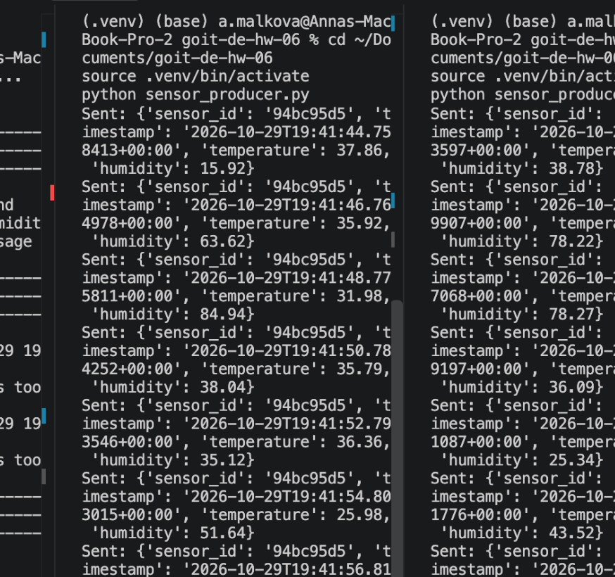
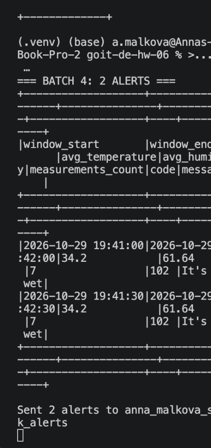
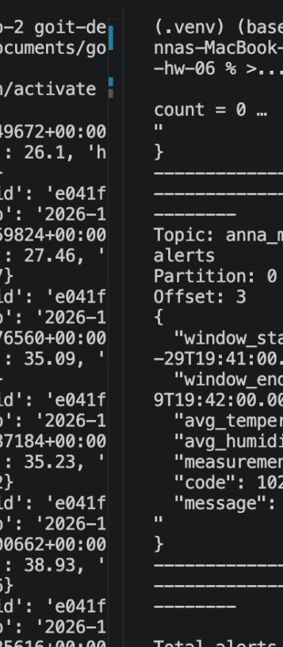

cd ~/Documents/goit-de-hw-06

# Распаковываем скриншоты, если архив уже скачан
if [ -f ~/Downloads/hw06_screenshots.zip ]; then
  unzip -o ~/Downloads/hw06_screenshots.zip -d .
fi

cat > README.md <<'EOF'
# Домашнє завдання №6 — Spark Structured Streaming

**Курс:** Data Engineering  
**Студентка:** Малькова Анна

## Мета роботи

Реалізувати потокову обробку показників IoT-датчиків за допомогою Apache Kafka та PySpark Structured Streaming.

## Технології

- Python 3.13
- PySpark 4.0.4
- Apache Kafka 4.1.2
- Docker Compose
- kafka-python 3.0.12

## 1. Генерація даних сенсорів

Скрипт `sensor_producer.py` імітує роботу IoT-датчика.

Кожен запуск отримує власний `sensor_id` та кожні дві секунди надсилає показники температури й вологості до Kafka-топіка `anna_malkova_building_sensors`.

Одночасно запущено два незалежні сенсори.

## 2. Агрегація даних у Spark Streaming

Скрипт `stream_alerts.py` зчитує потік даних із Kafka та обчислює:

- Середню температуру.
- Середню вологість.
- Кількість отриманих вимірювань.

Параметри агрегації:

- Window — 1 хвилина.
- Sliding interval — 30 секунд.
- Watermark — 10 секунд.

## 3. Перевірка умов алертів

Правила завантажуються з `alerts_conditions.csv`.

За допомогою `crossJoin` агреговані показники порівнюються з умовами:

- 101 — It's too dry.
- 102 — It's too wet.
- 103 — It's too cold.
- 104 — It's too hot.

Для відповідних умов формуються повідомлення з кодом, текстом та агрегованими значеннями.

## 4. Відправлення алертів до Kafka

Сформовані алерти записуються в топік `anna_malkova_spark_alerts`.

На скриншоті видно роботу Spark Streaming, два сформовані алерти та підтвердження їх відправлення до Kafka.

## 5. Перевірка результатів

Скрипт `verify_kafka_alerts.py` читає повідомлення з вихідного Kafka-топіка.

Перевірено отримання чотирьох алертів із полями:

- window_start
- window_end
- avg_temperature
- avg_humidity
- measurements_count
- code
- message

## Запуск проєкту

1. Запустити Kafka через `docker compose up -d`, якщо брокер ще не працює.
2. Створити вхідний топік `anna_malkova_building_sensors`, якщо його ще немає.
3. Встановити залежності: `pip install -r requirements.txt`.
4. Запустити обробку: `python stream_alerts.py`.
5. У двох терміналах запустити: `python sensor_producer.py`.
6. Перевірити результат: `python verify_kafka_alerts.py`.

## Результат

Реалізовано повний цикл:

**Kafka → Spark Structured Streaming → Window Aggregation → Cross Join → Alert Filtering → Kafka**

Підтверджено одночасну роботу двох сенсорів, обробку потокових даних, формування алертів та їх успішне читання з Kafka.
EOF

ls -lh screenshots